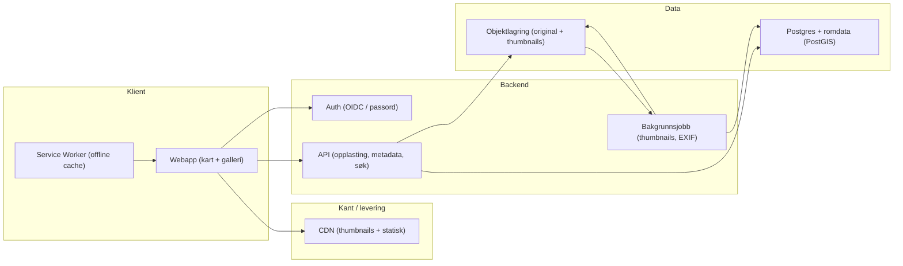
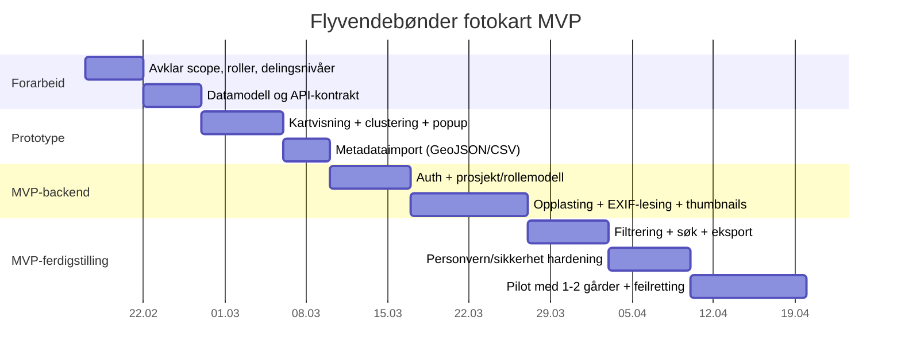

# Videreutvikling av Flyvendebønder: metodevalg og MVP for fotokart

## Executive summary

Flyvendebønder fremstår per februar 2026 som et tidlig fase pilotprosjekt med en minimal “pilotlogg”-nettside og en planlagt arbeidsflyt der droneflyginger lastes opp i «Presis», og kartprodukter bestilles og leveres i en repeterbar løype (plan → fly → opplasting → tolkning → leveranse). citeturn1view0turn3view0turn3view2 Samtidig er det lite som tyder på at flyvendebønder.no i dag er et system for lagring/visning av bilder eller geodata—det er primært en publiseringsflate for notater og eksempler. citeturn1view0

To sammenligne alternativer gir følgende hovedbilde: Å videreutvikle “nåværende metode” (dvs. Presis/PRESISnet + rapportmaler + publisering av resultater) er raskest og lavest risiko for å skape verdi i pilotåret 2026, men låser leveranse- og visningsformater til det PRESISnet og Gårdskart støtter, og dekker ikke nødvendigvis behovet for et lettvekts “fotodagbok på kart” som kan brukes i felt og deles. citeturn1view0turn3view0turn3view2 Å bygge et eget førsteversjons-program som viser bondens bilder på et interaktivt kart gir større fleksibilitet i brukeropplevelse, eierskap til informasjonsarkiv, deling og personvernstyring, men krever bevisste valg om geotagging, dataflyt, sikkerhet, lisensiering av kartbakgrunn og GDPR-roller (behandlingsansvarlig/databehandler). citeturn8search4turn8search12turn14search0turn17search2

En pragmatisk anbefaling er en todelt strategi: Fortsett pilotløypa med PRESISnet for agronomiske kartprodukter og målbar nytte i 2026, men etabler parallelt et MVP-fotokart som (i første omgang) kan være “admin-/pilotstyrt” (én eller få brukere/roller) og integreres på flyvendebønder.no som en egen visningsdel. Dette gir tidlig demonstrerbar funksjonalitet (bilder på kart), uten at man må lande alle “plattformvalg for alltid” før man har brukerinnsikt fra felt. citeturn1view0turn3view0turn6search3

## Nåværende nettside og idégrunnlag

Flyvendebønder.no (IDN-domene med ø/å, teknisk servert som punycode-variant) beskriver et pilotprosjekt i 2026 på Meen gård, med mål om lav terskel, tydelig dokumentasjon og filer som kan brukes videre. citeturn1view0 Arbeidsflyten som omtales er eksplisitt knyttet til droneflyging + «Presis», der man gjennomfører 1–3 flyginger i sesong, laster opp og bestiller relevante kartprodukter, og standardiserer rapportmaler underveis. citeturn1view0 Nettsiden beskriver også en publiseringsplan: kvartalsvise korte notater “hva vi gjorde, hvilke produkter vi brukte, hva vi lærte, og et lite utvalg kartutsnitt/eksempler”, med mål om “før/etter”-grunnlag og prismodell. citeturn1view0

Selve “Presis” i denne konteksten samsvarer med entity["organization","NIBIO","norwegian bioeconomy institute"] sin tjeneste PRESISnet: en arbeidsflyt for å laste opp dronedata, definere interesseområde og bestille kartprodukter. citeturn3view0turn3view2 PRESISnet-dokumentasjon beskriver fire faser (opplasting → interesseområde → bestilling → visning/nedlasting), og at ferdige produkter kan vises i Gårdskart og lastes ned i GeoJSON og shapefil (tildelingskart også i ISOXML-varianter). citeturn3view0

### Antatte dataformater og metadata i dagens “metode”

Det er viktig å skille mellom: (a) hva flyvendebønder.no selv “inneholder”, og (b) dataflyten i metoden den beskriver.

Nettsiden i seg selv ser ut til å være en statisk informasjons- og loggside uten eksplisitt datakatalog, opplastingsfunksjon, API eller synlig datamodell. Det finnes heller ikke på siden en spesifikasjon av hvilke filformater (bilder, geodata) som publiseres, eller hvilke metadata som beholdes/fjernes. Dette er derfor uspesifisert per nå. citeturn1view0

Metoden (PRESISnet) gir derimot klare indikasjoner på dataformater og metadata:

- **Inputtyper (dronedata):** Dokumentasjonen sier at man ved opplasting velger dronetype, og at systemet per i dag støtter DJI Phantom 4 RTK (RGB), DJI Phantom 4 Multispektral og DJI Mavic 3 Multispektral. citeturn3view0turn3view1 Dette antyder at input består av kameradata (bilder + sensormetadata) fra disse plattformene, men PRESISnet-siden konkretiserer ikke i teksten hvilke filendelser som forventes (f.eks. JPG/TIFF + sidecar). Det er derfor delvis uspesifisert i åpen dokumentasjon. citeturn3view0turn3view1  
- **Interesseområde (flatefil):** Interesseområdet “legges inn ved hjelp av en flatefil”, enten fra Gårdskart sin flatefil-funksjon eller fra GIS-verktøy som QGIS. citeturn3view0 Dette peker mot vanlige polygonformater (typisk shapefile eller GeoJSON), men eksakt formatkrav i opplastingen bør verifiseres i selve løsningen/brukergrensesnittet (ikke synlig i teksten). citeturn3view0  
- **Output (kartprodukter):** Ferdige produkter kan lastes ned som **GeoJSON** og **shapefil**, med ekstra ISOXML-støtte for tildelingskart til traktorterminaler. citeturn3view0  
- **Tilgjengelige produkter:** Avhengig av dronetype (RGB vs multispektral) får man ulike produktalternativer (f.eks. ugraskart i gulmoden åker for RGB; flere alternativer for multispektral). citeturn3view0turn3view2

### Begrensninger som følger av dagens metode

De tydeligste begrensningene (slik de fremstår fra dokumentasjonen) er:

- **Dronescope/kalibrering:** Systemet beskrives som “kalibrert for” bestemte droneplattformer og anbefaler å holde seg til disse for best resultat. citeturn3view1  
- **Fokus på agronomiske kartprodukter, ikke fotopresentasjon:** PRESISnet gir kartlag og tildelingsfiler, og visningen skjer i Gårdskart (“Se i kart”). citeturn3view0turn3view2 Dette dekker ikke automatisk et behov for å presentere “bondens egne bilder” som et kuratert fotogalleri på kart (med popups, tidslinje, deling), med mindre man bygger et eget visningslag eller en ny løsning.  
- **Personvern og datatyper:** Dronebruk kan innebære innsamling av bilder, video og lokasjonsdata som kan knyttes til enkeltpersoner; dette gir plikt til å forholde seg til personvernregelverket for virksomheter. citeturn8search28

## Sammenligning av alternativer: videreutvikle metode vs bygge fotokart

Denne sammenligningen tar utgangspunkt i to reelle utviklingsbaner:

- **Alternativ A:** Videreutvikle nåværende metode (PRESISnet + standardiserte rapportmaler + publisering på flyvendebønder.no).
- **Alternativ B:** Lage eget program som i første versjon viser bondens bilder på et interaktivt kart (med mulighet for senere utvidelser).

### Sammenligning på sentrale kriterier

| Kriterium | Alternativ A: Videreutvikle metode | Alternativ B: Eget fotokart |
|---|---|---|
| “Time-to-value” i 2026-piloten | Høy: ruller videre på eksisterende plan (1–3 flyginger, Presis-opplasting, bestilling, rapportering). citeturn1view0turn3view0 | Moderat: rask MVP er mulig, men krever utvikling og tydelig scope for opplasting/geotagging/visning. |
| Fleksibilitet i visning og historikk | Begrenset til visning/nedlasting slik PRESISnet/Gårdskart støtter. citeturn3view0turn3view2 | Høy: kan designes for feltbruk (cluster, popups, galleri, tidslinje) og deling på egne premisser. citeturn6search0turn6search3 |
| Dataeierskap og portabilitet | God portabilitet på output (GeoJSON/shp/ISOXML), men selve “arbeidsprosessen” og UI er bundet til tjenesten. citeturn3view0 | Full kontroll på datamodell og eksport (GeoJSON, CSV, backups), men du må implementere selv. |
| Risiko (teknisk/operasjonell) | Lavere: mindre ny programvare å drifte. | Høyere: filopplasting og karttjenester krever sikkerhetstiltak (validering, tilgangsstyring). citeturn17search0 |
| Personvernstyring og deling | Deling/publisering skjer via dine kanaler, men databehandling følger PRESISnet for analysen; ansvarsdeling må avklares. citeturn8search26turn3view0 | Du må etablere behandlingsgrunnlag og rutiner for bilder/posisjon og eventuelt samtykker; gir også mulighet for finmasket tilgang (privat/delt/offentlig). citeturn8search4turn8search5turn17search2 |
| Offline/felttoleranse | Avhenger av PRESISnet/Gårdskart; nettsida er uansett nettbasert. citeturn1view0 | Kan bygges som PWA med offline-first caching av app-shell, kart og thumbnails der det er hensiktsmessig. citeturn6search3turn6search23 |

### Rigorøs vurdering: hva “flyvendebønder” egentlig trenger i neste fase

I pilotåret 2026 er kjernehypotesen på flyvendebønder.no om droneflyging + Presis kan gi et praktisk beslutningsgrunnlag i drift “med lav friksjon for bonden”, og at man vil lære hva som tar tid og hva som gir mest verdi. citeturn1view0turn3view0 Denne hypotesen ligger nærmest Alternativ A.

Samtidig er ønsket ditt (i denne bestillingen) spesifikt: “lage et eget program som i første versjon viser bondens bilder plassert på et interaktivt kart.” Det behovet er bare indirekte dekket av Alternativ A, fordi PRESISnet primært er en arbeidsflyt for agronomiske kartprodukter og tildelingsfiler—ikke en kuratert fotologg. citeturn3view0turn3view2

En sterk syntese er derfor: **La PRESISnet være “analyse-/kartproduktmotoren”, og la fotokartet være “dokumentasjon-/formidlingslaget” (med tydelig personvern- og lisensramme).** Det gjør det mulig å publisere både “produkter” (kartlag, før/etter) og “bevismateriale” (bilder i tid/sted) på en måte som er forståelig og delbar. citeturn3view0turn6search0turn8search4

## Kravspesifikasjon for MVP som viser bilder på kart

Dette er en kravspesifikasjon for et minimum levedyktig produkt (MVP) som viser bilder på et interaktivt kart, med opplasting, geotagging, filtrering og brukerroller. Den er formulert slik at dere kan starte “smalt”, men ikke låse dere ute fra senere skalering.

### Funksjonelle krav

Tabellen under beskriver MVP-krav som er realistiske å levere i en første iterasjon.

| Område | MVP-krav | Kommentar / “minimum” |
|---|---|---|
| Opplasting | Last opp ett eller flere bilder (drag&drop, mobil). | Batch-opplasting er viktig for feltflyt. |
| Metadata-ekstraksjon | Les EXIF GPS (lat/lon), tidspunkt (DateTimeOriginal), retning (om tilgjengelig), kamerainfo. GPS-tags er del av EXIF-standarden. citeturn16search0turn16search11 | Hvis ingen GPS: markeres som “ikke geotagget”. |
| Geotagging uten EXIF | Manuell plassering på kart (pin-drop) + valg av usikkerhet (radius). | Unngå at user “faker” presisjon. |
| Visning på kart | Marker for hvert bilde; popup med thumbnail, dato, kort tekst; klikk til “bildevisning”. | Kartbibliotek må støtte popups/overlays. citeturn15view1turn15view0 |
| “Decluttering” | Clustering av punkter ved zoom ut (uansett bibliotek), med zoom-to-cluster. | Leaflet: markercluster-plugin. citeturn6search0 Mapbox GL JS: innebygd clustering. citeturn6search1 OpenLayers: Cluster source. citeturn6search2 |
| Filtrering | Filter på dato (fra–til), tagger/kategori, gård/skifte (hvis modellert), og “kun geotagget/ikke geotagget”. | Datamodell må støtte dette uten tunge joins (se ER). |
| Brukerroller | Minst to roller: Admin (full kontroll), Bidragsyter (opplasting/egne bilder). Gjest (lesetilgang) valgfritt. | GDPR og deling påvirker standardtilgang. citeturn8search4turn8search8 |
| Eksport | Eksporter bildeliste som CSV/GeoJSON (bilder som punktfeatures med metadata). | GeoJSON er “de facto” for webkart og støttes i Mapbox og andre biblioteker. citeturn6search5turn3view0 |
| Sletting | Admin kan slette bilde + tilhørende filer, og logge slettingen. | Kobles til rettigheter og “rett til sletting”. citeturn8search11 |

### Ikke-funksjonelle krav

Disse kravene handler om kvalitet, drift og etterlevelse.

| Område | MVP-krav | Begrunnelse / implikasjon |
|---|---|---|
| Ytelse | Last kart + første datalast < 3 sek på mobilnett i “normalbruk”; progressive thumbnails. | Kartopplevelse faller raskt hvis alt lastes upfront. |
| Skalerbarhet | Arkitektur som kan gå fra 100 → 100 000 bilder uten total omskriving (tiltak: paging, clustering, server-side filtrering). | Mapbox har egne råd for store GeoJSON-kilder; ofte må man dele opp og optimalisere. citeturn6search9 |
| Sikkerhet | Sikker filopplasting (validering av filtype/størrelse, malware-sjekk ved behov, isolert lagring). | OWASP peker på filopplasting som et høyrisikoområde og anbefaler praksiser for å hindre ondsinnede filer. citeturn17search0turn17search11 |
| Personvern/GDPR | “Privacy by design”: dataminimering, tilgangsstyring, logging, tydelige delingsnivåer (privat/delt/offentlig). | Bilder av gjenkjennelige personer er personopplysninger. citeturn8search4turn8search8 |
| Offline-støtte | App-shell og nylig brukte kart/thumbnail-cacher via service worker; offline kø for opplasting kan være “fase 2”. | Service workers muliggjør “offline first” caching og krever HTTPS. citeturn6search3turn6search23 |
| Robusthet | Backups av metadata + immutabel lagring av originale bilder (eller versjonering). | Viktig hvis dette blir “dokumentasjonsarkiv”. |
| Sporbarhet | Audit-logg for opplasting/redigering/sletting. | Underbygger ansvarlighet (accountability) i GDPR-praksis. citeturn8search11turn17search2 |

### Støttede bildeformater og metadata

**Anbefalt MVP-støtte i nettleser (visning):** JPEG, PNG, WebP, med mulighet for moderne formater via fallback-strategi. En praktisk tilnærming er å konvertere opplastede bilder til en “kanonisk” visningsvariant (f.eks. JPEG/WebP) og generere thumbnails, uansett originalformat. Nettleserstøtte for formater varierer, og MDN anbefaler å velge formater basert på nettleserstøtte og bruksbehov. citeturn16search2

**HEIC/HEIF:** Mange brukere på mobil (særlig iOS) kan ha HEIC, men nettleserstøtten er ujevn, og caniuse peker på lisens-/kompleksitetsutfordringer for HEIC-støtte i nettlesere. citeturn16search1 Derfor er et robust MVP-grep: **tillat opplasting av HEIC, men konverter serverside til JPEG/WebP for visning**, og lagre originalen hvis dere trenger arkivkvalitet.

**Metadata dere bør støtte/lagre (MVP):**
- GPSLatitude/GPSLongitude (+ refs) og evt. GPSImgDirection, der disse feltene finnes; EXIF GPS tags er standardiserte og dokumentert i flere metadata-verktøy. citeturn16search0turn16search11  
- DateTimeOriginal for tidslinje og filtrering. citeturn16search12  
- Egen, redigerbar meta: tittel/tekst, tagger, “gjelder skifte/område”, delingsnivå, og (valgfritt) kobling til Presis-leveranse eller rapport.

## Teknologistack, prototypearkitektur og gjennomføringsplan

### Teknologistack-alternativer

#### Frontend: Leaflet vs Mapbox vs OpenLayers

Denne sammenligningen vektlegger det dere faktisk trenger i et fotokart: enkel interaktivitet, clustering, popups, og integrasjon mot GeoJSON/API.

| Alternativ | Styrker | Svakheter | Når det passer best |
|---|---|---|---|
| Leaflet | Lettvekts, enkel API, stor plugin-økologi; markører/popup/GeoJSON støttes direkte. citeturn15view1 | Mer “byggeklosser” enn full tilnærming; avansert styling/vektordata krever ekstra komponenter. | MVP og hurtig prototyping; når dere vil eie drift av kartbakgrunn selv (OSM/WMTS). |
| Mapbox GL JS | Høy ytelse og moderne vektorkart; clustering er innebygd; pris modellert per map load med gratisnivå opp til 50 000/mnd. citeturn13view0turn6search1turn11view0 | Vendor lock-in til Mapbox-økosystem; krever token-håndtering; kommersielle vilkår/ToS. citeturn7search7turn7search26 | Når dere prioriterer “best mulig kartopplevelse” og aksepterer løpende kost/avhengighet. |
| OpenLayers | Feature-rik, støtter mange datakilder (XYZ, OGC-tjenester, vektortiles) og er åpen kildekode. citeturn15view0 | Større kompleksitet enn Leaflet for en enkel fotologg. | Når dere trenger mye GIS/OGC-integrasjon (WMS/WFS) eller komplekse lag. |

**Anbefaling (MVP):** Start med **Leaflet** for første versjon dersom dere vil holde kompleksitet lav og integrere i eksisterende flyvendebønder.no raskt, og bruk clustering via Leaflet.markercluster. citeturn15view1turn6search0 Dersom dere vet at dere vil ha veldig høy trafikk eller tung vektor-rendering og vil betale for en “batteries included” kartplattform, er Mapbox GL JS et reelt alternativ, spesielt fordi clustering, ytelsesråd for GeoJSON og klar pris per map load allerede finnes. citeturn6search9turn13view0turn11view0

image_group{"layout":"carousel","aspect_ratio":"16:9","query":["Leaflet marker cluster photo map example","Mapbox GL JS cluster popup example","OpenLayers cluster example"],"num_per_query":1}

#### Backend: serverless vs tradisjonell API

To arketyper dekker de fleste MVP-behov:

- **Serverless (f.eks. AWS Lambda + API Gateway):** Lambda kjører kode på hendelser og håndterer ressurser automatisk. citeturn10search17turn10search1 Når dere frontes av API Gateway, betaler dere typisk per kall (samt datatransfer), og AWS viser konkrete priseksempler på API-kall. citeturn10search2  
- **Tradisjonell API (container/VPS):** Et vedvarende API (f.eks. Node/FastAPI) gir forutsigbar runtime, enklere lokal debugging og ofte mindre “tjeneste-orkestrering”, men dere drifter patching, skalering og overvåkning mer selv.

**MVP-anbefaling:** Serverless er ofte gunstig for en opplast/metadata-API med ujevn trafikk, fordi dere kan komme langt innenfor gratisnivå og betale lite ved lav bruk (Lambda har 1 million gratis forespørsler per måned i free tier, og $0.20 per million requests etterpå i eksemplene). citeturn10search17turn10search1 For en offentlig tjeneste med stabil trafikk og større team kan tradisjonell API være enklere å drifte samlet, men dette avhenger av kompetanse og forventet last.

#### Lagring: S3/MinIO

| Alternativ | Styrker | Svakheter / risiko |
|---|---|---|
| S3-kompatibel, managed object storage (eks. AWS S3) | Høy holdbarhet, enkel integrasjon, skalerer godt; pris per bruk og eksempler på request-kost finnes i AWS-dokumentasjon. citeturn18view0turn10search0 | Kost kan dominere i egress/utlevering hvis dere ikke bruker CDN eller optimaliserer thumbnails. citeturn18view0 |
| MinIO (self-hosted S3-kompatibel) | Gir S3-API i eget miljø; kan passe der man vil ha full kontroll eller on-prem. | Lisens er dual: GNU AGPL v3 eller kommersiell lisens, og AGPL kan blant annet utløse krav om å distribuere kildekode ved “hosting over nett” for kombinerte verk. citeturn5search3turn5search7 |

**MVP-anbefaling:** Bruk managed object storage (S3-klasse eller tilsvarende hos EU/EEA-leverandør) for å redusere driftsrisiko. Hvis dere vurderer MinIO, bør lisensvalget (AGPL vs kommersiell) avklares tidlig, fordi det påvirker juridisk risiko og produktstrategi. citeturn5search3

#### Database: PostGIS vs NoSQL

| Alternativ | Styrker | Svakheter |
|---|---|---|
| PostgreSQL + PostGIS | PostGIS lar geodata lagres i databasen og støtter GiST-baserte R-tree spatial indexes og funksjoner for analyse/operasjoner. citeturn7search27turn7search3 | Krever skjema-/migrasjonsdisiplin; høyere terskel enn “ren dokumentlagring”. |
| NoSQL (eksempel: MongoDB) | MongoDB støtter geospatiale spørringer og 2dsphere-indekser for GeoJSON og WGS84. citeturn7search4turn7search18 | Geospatiale behov utover “punkt nær punkt” kan bli mer begrensende enn i PostGIS; transaksjoner og relasjoner (bilder–tags–roller) blir ofte mer komplekse. |

**Anbefaling:** For et fotokart er PostGIS vanligvis mest robust fordi dere får moden romlig indeksering, mulighet for avgrensningsspørringer (bbox), nærhetssøk, og ryddig håndtering av geometri med SQL. citeturn7search3turn7search27 NoSQL kan fungere hvis dere kun trenger enkle punktspørringer og vil optimalisere for dokumentlagring, men “kartfilter + roller + deling + historikk” tenderer mot relasjonell modell.

### Prototypearkitektur

Dette er en prototypearkitektur som kan implementeres trinnvis, med klart skille mellom blob-lagring (bilder) og metadata (DB). Den er bevisst “modulær” slik at dere kan bytte kartbibliotek og hosting senere.



Arkitekturen gjør det mulig å:
- lytte på “image uploaded” og generere thumbnails/derivater,
- bruke pre-signede URL-er eller tokenbasert tilgang til bilder,
- cache thumbnails og kartressurser for feltbruk via service worker. citeturn6search3turn6search23

### Foreslått datamodell

Datamodellen under er bevisst enkel, men dekker geotagging, deling og filtrering. “geometry” er typisk POINT (WGS84), og usikkerhet kan representeres som meter (radius).

```mermaid
erDiagram
  USER ||--o{ PHOTO : uploads
  USER ||--o{ MEMBERSHIP : has
  PROJECT ||--o{ MEMBERSHIP : includes
  PROJECT ||--o{ PHOTO : contains
  PHOTO ||--o{ PHOTO_TAG : has
  TAG ||--o{ PHOTO_TAG : links
  PHOTO ||--o{ ASSET : derives

  USER {
    uuid id
    string email
    string display_name
    string role_global
    datetime created_at
  }

  PROJECT {
    uuid id
    string name
    string description
    string visibility_default
    datetime created_at
  }

  MEMBERSHIP {
    uuid id
    uuid user_id
    uuid project_id
    string role_project
    datetime created_at
  }

  PHOTO {
    uuid id
    uuid project_id
    uuid uploader_user_id
    string title
    string caption
    datetime taken_at
    string visibility
    point geometry_wgs84
    float location_accuracy_m
    string source_format
    json exif_subset
    datetime created_at
  }

  ASSET {
    uuid id
    uuid photo_id
    string kind  // original|thumb|small|large
    string mime
    int width
    int height
    int bytes
    string storage_key
    datetime created_at
  }

  TAG {
    uuid id
    uuid project_id
    string name
  }

  PHOTO_TAG {
    uuid photo_id
    uuid tag_id
  }
```

Dette gir “MVP-kompatible” spørringer:
- filer på kart innen bbox,
- filter på tidsrom (taken_at),
- filter på tagger,
- adgangskontroll per prosjekt og foto.

### Enkel implementasjonsplan med tidsrammer og milepæler

Tidsestimatene under antar én utvikler med “normal” flyt og at MVP holdes stramt (admin + bidragsyter, enkel deling). Dersom dere skal ha avansert rollemodell, revisjonshistorikk, eller mobilapp fra dag 1, øker varigheten.



Det er samtidig naturlig å synkronisere milepæler med flyvendebønder.no sin Q1/Q2/Q3/Q4-plan (Q2 første leveranse osv.), slik at fotokartet kan brukes som dokumentasjon i kvartalsnotatene. citeturn1view0

### Avklaringer som vil påvirke design

Følgende er ikke spesifisert i kildene og vil påvirke både krav og kost/beslutninger:

- Skal kartet være **offentlig**, “delt via lenke”, eller kun for innloggede? (påvirker GDPR-kontroller og tile-usage). citeturn14search0turn8search4  
- Skal dere håndtere **bilder fra drone** (f.eks. ortofoto) i tillegg til vanlige foto? (påvirker filstørrelser og visningsstrategi).  
- Skal geotagging være **presis punkt** eller også støtte **polygon “skifte/område”** (kobling mot flatefil slik PRESISnet gjør)? citeturn3view0  
- Hvilken “datadeling” må støttes (eksport/arkivkrav)?

## Sikkerhet, personvern og lisenshensyn

### Personvern og GDPR: hva regnes som personopplysninger her

entity["organization","Datatilsynet","norwegian dpa"] er tydelige på at bilder eller film hvor en person kan gjenkjennes er personopplysninger. citeturn8search4 De er også tydelige på at publisering av portrettbilder (bilder der personer er hovedmotivet) vanligvis krever samtykke fra de avbildede før publisering, også i lukkede grupper. citeturn8search8

For droner peker Datatilsynet på at droner kan samle inn bilder/video og lokasjonsdata som kan knyttes til enkeltperson, og at virksomheter som tar i bruk droner som samler inn slike opplysninger må forholde seg til personvernregelverket. citeturn8search28

I et fotokart blir også “posisjon” og ofte “nett-identifikatorer” relevante: Datatilsynet nevner at cookie-ID, lokasjonsdata eller detaljert informasjon om brukernes enheter kan utgjøre personopplysninger. citeturn8search12

### Behandlingsgrunnlag, roller og dokumentasjon

Alle behandlinger av personopplysninger må ha behandlingsgrunnlag; Datatilsynet beskriver blant annet “nødvendig for å ivareta legitime interesser” og understreker at behandlingen må være nødvendig og minst inngripende (interesseavveiing). citeturn8search1turn8search9 Dersom dere baserer dere på samtykke, må samtykket kunne dokumenteres. citeturn8search5turn8search6

For et fotokart bør dere derfor (minst) ha:
- en personvernerklæring som forklarer formål, deling, lagringstid og rettigheter (innsyn/sletting) i tråd med informasjonsplikter. citeturn8search10turn8search11  
- en vurdering av om fotokartet er “privat bruk” eller del av virksomhet/tjeneste; EU-kommisjonen forklarer at GDPR ikke gjelder for rent personlig bruk uten profesjonell/kommersiell kobling, men gjelder når data brukes utenfor privat sfære. citeturn8search11  
- avklaring av om dere opptrer som behandlingsansvarlig alene, eller om dere bruker databehandlere (hosting, karttjenester) som krever databehandleravtaler.

### EXIF og geotagging: dataminimering som praktisk tiltak

EXIF GPS-tags (GPSLatitude/GPSLongitude m.m.) er en standardisert del av bilde-EXIF og kan leses/skrives av vanlige verktøy. citeturn16search0turn16search11 For et fotokart er disse feltene nyttige, men de øker også personvernrisiko hvis bilder deles bredt.

Et tydelig “privacy by design”-grep er derfor:
- lagre en **begrenset EXIF-subset** (kun det dere trenger for funksjonen),
- tilby “strip EXIF on publish” (f.eks. fjerne GPS fra offentlig delte bilder),
- ha delingsnivå som standard “privat” og kreve eksplisitt handling for å publisere.

### Teknisk sikkerhet: filopplasting, autentisering og drift

Filopplasting er et klassisk angrepspunkt, og OWASP anbefaler en rekke tiltak for å håndtere skadelige eller falske filer. citeturn17search0turn17search11 Praktisk betyr det for MVP:

- sjekk filtype både via MIME, filendelse og “magiske bytes” (ikke stol på Content-Type alene),
- begrens filstørrelse og antall filer per opplasting,
- lagre opplastinger i objektlagring uten direkte eksekvering (ikke i webroot),
- server bilder via sikre URL-er (kortlevde signerede lenker eller auth-gateway),
- loggfør opplasting/sletting.

På GDPR-sikkerhetssiden krever artikkel 32 at behandlingsansvarlig og databehandler iverksetter passende tekniske og organisatoriske tiltak basert på risiko, inkludert mulig pseudonymisering og kryptering. citeturn17search2

### Lisenshensyn for kartbakgrunn og komponenter

Det er tre lisens-/policyflater som ofte blir oversett i kartprosjekter:

1) **OpenStreetMap-tiles**: OpenStreetMap-data kan brukes, men OSMF sin tile-tjeneste har en “Tile Usage Policy” som advarer mot “heavy or inappropriate use” og kan blokkere tilgang ved degradering av tjenesten. citeturn14search0 OSM krever også tydelig attribusjon og at det fremgår at data er under ODbL. citeturn14search1  
2) **Mapbox**: Mapbox har kommersielle vilkår (ToS) og priser for Mapbox GL JS basert på map loads, med gratisnivå opp til 50 000 per måned og deretter kost per 1 000. citeturn7search26turn13view0  
3) **Åpen kildekode-lisenser og copyleft**: Leaflet og OpenLayers er BSD-lisensierte (permissive), mens MinIO er AGPL/kommersiell dual-lisens med eksplisitte krav ved nettverksbruk dersom man velger AGPL-sporet. citeturn5search0turn5search1turn5search3

## Kostnadsoverslag, prioriterte kilder og forslag til videre validering

### Kostnadsoverslag i tre skalaer

Dette er et overslag basert på “typiske” komponenter for et fotokart: kartvisning, API, objektlagring og database. Kost varierer sterkt med trafikk (map loads), antall bilder og datatrafikk (thumbnails/fullbilder). Mapbox-prising er konkret per map load, og gratisnivået er opp til 50 000 map loads/mnd. citeturn13view0turn11view0 AWS Lambda har 1M gratis requests/mnd og $0.20 per million requests etter det; API Gateway og S3 har per-request og data transfer-komponenter som kan dominere ved stor utlevering. citeturn10search1turn10search2turn18view0

For å gi NOK-anker brukes en “omtrentlig dagskurs” USD/NOK ≈ 9,50 fra børsvisning; dette vil svinge. citeturn9search24

| Skala | Antatt bruk (illustrativt) | Kartplattform | Hosting/API | Lagring (bilder) | DB | Ca. månedsestimat |
|---|---|---|---|---|---|---|
| Hobby / pilot | 1–2 prosjekter, 1–5k bilder, <10k sidevisninger/mnd | Leaflet + OSM/annen tileleverandør (lav kost, men pass på OSM-policy) citeturn14search0turn15view1 | Serverless innenfor free tiers (Lambda 1M free requests). citeturn10search17turn10search1 | 10–50 GB objektlagring | Liten Postgres (evt. billig managed) | 0–500 NOK/mnd (ofte nær 0 hvis gratisnivå) + domene |
| Liten tjeneste | 10–50 prosjekter, 50–500k bilder totalt, 20–80k map loads/mnd | Mapbox GL JS kan være “enkelt” (50k gratis, deretter $5/1000 for 50,001–100k). citeturn13view0 | Lambda/API Gateway med moderat bruk (kall + datatransfer). citeturn10search1turn10search2 | 100–500 GB + CDN for bilder | Managed Postgres/PostGIS | ~ 500–5 000 NOK/mnd (avhenger mest av map loads + egress) |
| Produksjon | 100+ prosjekter, 1–5 TB bilder, 200k–1M+ map loads/mnd | Mapbox betalt (kost per 1000 load faller med volum; fra $4/$3 per 1000 i høyere trinn). citeturn13view0 | Skalert serverless eller container + observability | TB-skala lagring + betydelig egress | HA Postgres/PostGIS + backups | ~ 5 000–50 000+ NOK/mnd (stor variasjon; egress og Mapbox dominerer ofte) |

Tolkning: For hobby og tidlig pilot er det realistisk å holde total drift svært lav ved å bruke statisk hosting og gratisnivåer, men dere må være bevisste på at OpenStreetMap sine offentlige tiles ikke er ment for tung eller distribusjonsdrevet bruk, og kan blokkere ved policy-brudd. citeturn14search0 Når dere passerer et visst volum eller trenger SLA, blir enten betalte tileleverandører (Mapbox eller andre) eller egen tileinfrastruktur relevant. citeturn13view0turn14search5

### Kilder å prioritere videre

Tabellen under er en “prioritert leseliste” for neste fase, med vekt på norske/autoritative kilder der det finnes.

| Tema | Kilder å prioritere |
|---|---|
| Flyvendebønder og pilotkontekst | flyvendebønder.no sin beskrivelse av mål, flyt og kvartalsplan. citeturn1view0 |
| Presis/PRESISnet arbeidsflyt og formater | PRESISnet “Arbeidsflyt” (opplasting, flatefil, bestilling, nedlasting GeoJSON/shp/ISOXML). citeturn3view0 |
| Brukererfaring og landbruksrelevans | Norsk Landbruksrådgiving-artikkel om “Presis” i Gårdskart og praktiske eksempler. citeturn3view2 |
| Kartbibliotek (offisielle docs) | Leaflet oversikt og API/bruk. citeturn15view1turn7search10 OpenLayers oversikt og formater/OGC-støtte. citeturn15view0 Mapbox GL JS clustering og pricing. citeturn6search1turn11view0turn13view0 |
| Geodatabase | PostGIS docs (geodata + GiST/R-tree) og spatial index FAQ. citeturn7search27turn7search3 |
| Personvern (norske kilder) | Datatilsynet om personopplysninger (bilder), deling av bilder, og virksomheters bruk av droner. citeturn8search4turn8search8turn8search28 |
| Sikker utvikling | OWASP File Upload Cheat Sheet (og evt. Session Management). citeturn17search0turn17search1 |
| Kart-/tile-lisenser | OpenStreetMap tile usage policy og attribusjonskrav. citeturn14search0turn14search1 Mapbox ToS og pricing. citeturn7search26turn13view0 |

### Forslag til videre tester og brukerundersøkelser

For å sikre at dere bygger “riktig ting” og ikke bare “ting riktig”, bør dere koble MVP tidlig til feltarbeidsflyten:

- Gjennomfør 3–5 strukturerte feltøkter med bønder/rådgivere der dere måler friksjon i: opplasting, geotagging (EXIF vs manuell), og gjenfinning/filtrering på kart.
- Test to delingsmodi: “privat prosjekt” vs “delt lenke” og mål hvor ofte brukere feildeler eller blir usikre på synlighet (kobles til GDPR-risiko for bilder). citeturn8search8turn8search5
- Kjør en ytelsestest med 10k / 100k punktfeatures og evaluer behov for server-side clustering/tiling (Mapbox og andre peker på at store GeoJSON-kilder krever best practices). citeturn6search9turn6search1
- Gjennomfør en “privacy tabletop”: vurder scenarioer der bilder inneholder personer/registreringsnummer, eller presis lokasjon er sensitiv (bosted, sårbare installasjoner), og definer default-regler (strip EXIF, lavere presisjon, avgrenset deling). citeturn8search4turn8search12turn16search0
- Hvis drone brukes: verifiser at arbeidsflyt inkluderer sjekk av flysoner og interne rutiner for hva som filmes/lagres. (Eksempel på relevant karttjeneste i Norge: Avinor dronekart beskriver restriksjonssoner rundt flyplasser). citeturn2search13