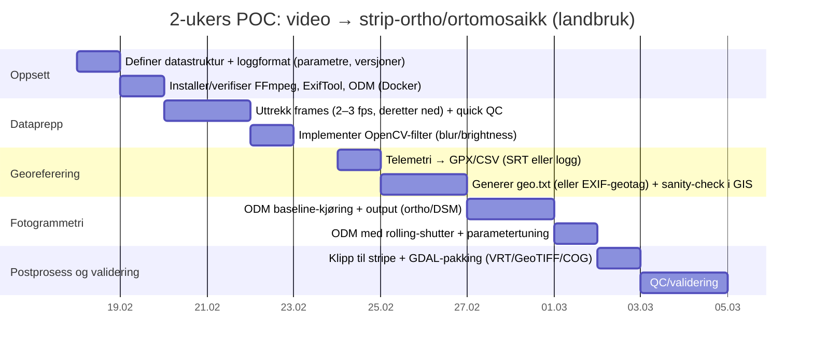

# Video til georeferert “stripe-ortho” og ortomosaikk med åpen kildekode og CLI for landbruk

## Executive summary

Å konvertere sammenhengende dronevideo til et **georeferert, sammenstilt “strip”-bilde** eller en **ortomosaikk** som er egnet til landbrukskartlegging er mulig med en ren CLI-basert, åpen-kildekode arbeidsflyt, men kvalitet og nøyaktighet blir ofte mer sårbar enn ved klassiske stillbilder. Dette skyldes særlig **kompresjon, motion blur, rullende lukker (rolling shutter), lavere effektiv oppløsning per frame, og utfordringer med presis geotagging per frame**. citeturn22search0turn9search6turn9search2turn16view0turn9search13

Den mest “rett fram”-robuste open-source kjeden for landbruk er:

1) **Video → frames** (kontrollert uttrekk og/eller nøkkelframevalg) med **FFmpeg** (+ eventuelt OpenCV-basert kvalitetssiling). citeturn10search16turn6view0turn6view1  
2) **Telemetry → posisjon per frame** via SRT/flightlog til GPX/CSV og deretter enten:
- geotagge frames med **ExifTool** (lineær interpolasjon langs spor), eller  
- lage en **ODM `geo.txt`** for eksakt styring av posisjon/RTK/INS-data per bilde. citeturn9search6turn9search2turn20view0turn25view0  
3) **Fotogrammetri → ortofoto/DEM/punktsky** med **ODM** (CLI, Docker) eller avansert alternativ **MicMac**. citeturn20view1turn14view0turn27search1  
4) **Mosaikk/format/leveranse** med **GDAL** (VRT/mosaikk) + (hvis multispektral data finnes) **OTB** for indekskart. citeturn27search3turn27search5turn30search1  

En viktig oppdagelse for “video-til-ortho”-sporet er at **ODM dokumenterer egne video-opsjoner** (`video-limit`, `video-resolution`) for å ekstrahere et begrenset antall frames fra video til prosessering. Det gir en “built-in” løsning, men du mister ofte kontrollen du får med en eksplisitt FFmpeg/OpenCV-pipeline. citeturn18view0turn18view1

For landbruk anbefales i utgangspunktet **høy overlapp**. Pix4D sine generelle anbefalinger viser at landbruksfelt typisk trenger **minst ~80% front- og side-overlapp**, mens korridor/single-track har egne overlappkrav (ofte høy front-overlapp). Dette kan brukes som kalibreringspunkt når du bestemmer frame-rate/uttrekk fra video. citeturn5view3

Til slutt: Dersom videoen inneholder mennesker/identifiserbare forhold, må du vurdere personvern. **Datatilsynet** presiserer at dronebruk kan innebære behandling av personopplysninger (bilder/video/lokasjon) og at virksomheter må følge personvernregelverket, inkl. minimering og formålsbegrensning. citeturn28view3turn3search7

## Målbilde, definisjoner og uspesifiserte antakelser

Et **ortofoto/ortomosaikk** er et bildeprodukt som er **georeferert** slik at det “stemmer med kartet” (kartgeometri), og kan brukes som bakgrunn i GIS og for analyse. citeturn28view1turn9search3

I denne konteksten betyr “video → strip-ortho” typisk ett av to produkter:

- **Langt georeferert ortofoto (“strip”)** som dekker flystripen, ofte et smalt polygon langs traséen (korridor).  
- **Ortomosaikk** (mer “kartflate”) dersom du har flere striper eller side-overlapp (grid/dobbelgrid).

Følgende forhold er ikke spesifisert i spørsmålet, og de påvirker valg av parametre og nøyaktighet (jeg bruker dem derfor som eksplisitte antakelser i eksemplene):

- Om **telemetri** finnes som separat fil (DJI `.SRT`, autopilotlogg) eller om video har **innebygd geotag/track**. citeturn25view0turn4view2turn4view7  
- Kamera-/droneplattform (DJI/Parrot/ArduPilot/PX4), om du har **RTK** eller kun standard GPS, og om kameraet er **rolling shutter**. citeturn20view0turn16view0turn16view2  
- Videoformat (H.264/H.265, container `.MP4/.MOV`) og bitrate, som påvirker artefakter/feature-matching. **FFmpeg** støtter bredt spekter av input og filtrering/transkoding. citeturn10search16turn22search0  
- Flyhøyde, hastighet, gimbal-tilt (nadir vs skrått). For kart/ortho er **nadir** normalt nødvendig; lav overlapp eller skrå vinkel øker risiko for mislykket prosessering. citeturn3search16turn5view3  

## Verktøykartlegging: open-source CLI som dekker video→frames→utvalg→georeferering→fotogrammetri

Tabellen under er prioritert etter “hvor direkte den hjelper deg å komme fra video til georeferert kartprodukt” i en landbruks-POC.

| Verktøy | Rolle i kjeden | Nøkkelfunksjoner for video→ortho | Lisens (praktisk) | GPU | Modenhet (proxy) |
|---|---|---|---|---|---|
| **entity["organization","FFmpeg","media framework cli"]** | Video ingest + frame extraction + filtrering | Frame-uttrekk (`fps`, `select`), filtrering, transkoding; støtter “select only I-frames”, “1 frame per N”, etc. citeturn6view0turn6view1turn10search16 | LGPL 2.1+ (men kan bli GPL hvis du bygger med GPL-deler). citeturn22search0 | Varierer (avhengig av build/hw-accel), men dette er mer decode/transcode enn SfM | Svært moden |
| **entity["organization","OpenCV","computer vision library"]** | Kvalitetsfilter + nøkkelframeheuristikk | Blur-detektering, scene-endring, feature-matching heuristikk; inneholder videostabilisering-modul (videostab). citeturn10search3turn22search5 | BSD 3-clause (til 4.4.0 og lavere; lisenshistorikk og endringer finnes). citeturn22search5turn22search9 | Mulig i enkelte moduler/byggevalg | Svært moden |
| **entity["organization","vid.stab","video stabilization library"]** | Stabilisering (2-pass) via FFmpeg | `vidstabdetect` + `vidstabtransform`; tydelig anbefaling om to-pass og at “deshake” er 1-pass alternativ. citeturn7view0turn5view0turn6view3 | (Se LICENSE i repo; integrasjon via FFmpeg krever riktig bygg). citeturn7view0turn5view0 | Nei (typisk) | Modent bibliotek |
| **entity["organization","ExifTool","metadata cli"]** | Metadata, geotagging og track-uttrekk | Geotagging fra GPX med lineær interpolasjon; definerer hvilke GPS-tags som må settes; kan generere GPX fra geotaggede filer og nevner at `-ee3` trengs for full track fra video. citeturn9search6turn9search2turn4view7 | “Samme vilkår som Perl” (Artistic eller GPL). citeturn23view0 | N/A | Svært moden |
| **entity["organization","OpenDroneMap","open-source drone mapping ecosystem"]** (ODM) | Fotogrammetri til ortho/DEM/punktsky | CLI (Docker) → georeferert ortofoto/DEM; støtter `geo.txt` for å overstyre posisjoner (RTK/INS) og kan bruke `video-limit`/`video-resolution` for å trekke frames fra video. citeturn20view1turn20view0turn18view0turn18view1 | AGPL-3.0 (sterk copyleft ved distribusjon/tilgjengeliggjøring). citeturn20view1turn28view0 | ODM docs sier GPU “har ingen effekt” på ytelse i dag (i anbefalingene). citeturn14view0 | Stor/etablert |
| **entity["organization","MicMac","photogrammetry suite ign ensg"]** | Alternativ fotogrammetri (avansert) | Svært kraftig CLI (`mm3d ... -help`), mye kontroll på pipeline. citeturn27search7turn27search1 | CeCILL-B (french-law tilpasset “LGPL-aktig”). citeturn27search1turn27search0 | Typisk CPU/parallel | Modent i fagmiljø |
| **entity["organization","COLMAP","sfm and mvs pipeline"]** | SfM/MVS (mer 3D enn ortho) | Full CLI, `automatic_reconstructor` og modulsteg; GPU-accelerert SIFT kan være relevant (avhenger av build). citeturn4view4turn1search15 | New BSD, men avhengigheter kan påvirke samlet binær. citeturn22search2turn22search2 | Ja, i enkelte steg/bygd | Modent |
| **entity["organization","openMVG","multiple view geometry library"]** | SfM byggestein (poses/sparsom punktsky) | Wiki beskriver hvordan kjøre SfM pipeline; ofte brukt før OpenMVS. citeturn4view6turn21search2 | MPL 2.0 (svak copyleft på filnivå). citeturn21search2turn21search14 | Varierer | Modent |
| **entity["organization","OpenMVS","multi-view stereo library"]** | Densifisering/mesh (etter SfM) | Fyller “siste del” av kjeden etter SfM; tett punktsky/mesh/tekstur. citeturn21search4turn21search13 | AGPL-3.0. citeturn21search0 | Varierer | Modent, men output mer 3D |
| **entity["organization","Meshroom","alicevision photogrammetry gui cli"]** | AliceVision pipeline (CLI mulig) | `meshroom_batch` / “photogrammetry pipeline” kan kjøres fra CLI. citeturn4view5turn1search1 | MPL 2.0 (repo). citeturn21search7 | GPU ofte viktig i depth-map steg (avhenger av build) | Modent |
| **entity["organization","GDAL","geospatial raster vector library"]** | Mosaikk/warp/COG/format | `gdalbuildvrt` (mosaikk som VRT), `gdal_merge` (mosaikk). citeturn27search3turn27search5 | MIT. citeturn13view4 | N/A | Svært moden |
| **entity["organization","Orfeo ToolBox","remote sensing image processing"]** | Indeksberegning (NDVI m.m.) | `RadiometricIndices` beregner radiometriske indekser fra bånd; CLI / RAM-parameter. citeturn30search1turn30search9 | Apache 2.0 (fra OTB 6.0+). citeturn30search0turn30search4 | Begrenset/fokuserer på streaming/CPU | Modent |
| **entity["organization","PDAL","point cloud processing"]** | Punktsky QC / rasterisering | Behandling av LAS/LAZ etc. | BSD. citeturn30search2 | N/A | Modent |
| **entity["organization","djiutil","dji file utility cli"]** | DJI SRT→GPX, filhåndtering | `djiutil convert` konverterer DJI SRT til GPX; beskriver avhengigheter og at SRT inneholder GPS/alt i tekst. citeturn4view3turn25view0 | MIT. citeturn25view0 | N/A | Mindre, men relevant |
| **entity["organization","DJI Drone Metadata Embedder","dji srt telemetry embedder"]** | DJI telemetri→metadata/GPX/CSV | CLI som kan embedde DJI SRT telemetri til MP4 + eksportere flight data JSON/GPX/CSV. citeturn24view0 | MIT. citeturn24view0 | N/A | Mindre, men presist relevant |
| **entity["organization","Video2ImageCLI","video frame extract odm cli"]** | “Video→frames→ODM” helper | Ekstraherer frames og kjører ODM; støtter rate/antall/percent-change osv; MIT. citeturn26view0 | MIT. citeturn26view0 | N/A | Ny/liten, men nyttig |

Viktig tolkning for landbruk: Verktøy som **COLMAP/openMVG/OpenMVS/Meshroom** er sterke for 3D-modeller, men krever ofte ekstra steg for å ende i en “GIS-klar” ortomosaikk, sammenlignet med ODM/MicMac som er mer rettet mot georeferert ortho/DEM-produksjon. citeturn20view1turn27search1turn4view4

## Detaljert video-arbeidsflyt og POC-pipeline for en 300 m flystripe

Denne arbeidsflyten er skrevet for “beste praksis” i en CLI-POC. Den kan kjøres i ren open-source, men noen deler (telemetri-format) er droneavhengig.

### Datainnsamling: hva du ideelt sett vil ha før du starter

For landbrukskartlegging bør du sikte på:

- **Nadir video** (gimbal peker ned), jevn høyde, jevn hastighet. Mange pipeline-feil skyldes skrå vinkel / varierende perspektiv, eller for lav overlapp. citeturn3search16turn5view3  
- **Høy overlapp**. Pix4D oppgir eksempelvis at landbruksfelt ofte trenger ca. **80% front- og sideoverlapp**, og at korridor/single-track trenger høy frontoverlapp. Dette brukes her som dimensjoneringsgrunnlag for frame-rate. citeturn5view3  
- **Minimér motion blur**. En norsk, praktisk tommelfingerregel er at maksimal lukkertid kan estimeres som `maks lukkertid = GSD / dronehastighet` for å unngå at et punkt flytter seg mer enn omtrent én GSD under eksponeringen. citeturn8search8  

### Steg A: Stabilisering (valgfritt) og grunnleggende avkoding

**Når stabilisering er nyttig:** kraftig vibrasjon/jitter kan gi dårlig feature matching.  
**Når stabilisering kan skade:** stabilisering introduserer variabel transform/crop per frame, som kan gjøre kameramodell/intrinsics mindre konsistent, og kan dermed forverre SfM/fotogrammetri. I landbruk anbefales ofte heller: bedre opptak (høy shutter), filtrere bort dårlige frames, og ikke “warp-e” geometrien unødig.

To open-source primærvalg:

- FFmpeg `deshake` (enkelt, 1-pass) citeturn6view3turn5view1  
- `vidstabdetect` + `vidstabtransform` (2-pass) via `vid.stab` (anbefalt for bedre resultater i tradisjonell stabilisering). citeturn7view0turn5view0  

**Eksempel (2-pass, stabilisert mellomvideo):**
```bash
# Pass 1: finn transformasjoner (ingen outputfil, bare analyse)
ffmpeg -i input.mp4 -vf vidstabdetect=shakiness=5:accuracy=15:result=transforms.trf -f null -

# Pass 2: påfør transformasjoner + litt unsharp
ffmpeg -i input.mp4 -vf vidstabtransform=input=transforms.trf:smoothing=10,unsharp=5:5:0.8:3:3:0.4 stabilized.mp4
```
(Valg av parametre er støttet av filterdokumentasjonen og vid.stab sin README som beskriver to-pass oppsettet.) citeturn5view0turn7view0  

### Steg B: Frame extraction med kontrollert rate

Du har tre realistiske strategier:

**Strategi B1: Jevn tidsrate (`fps`)**  
FFmpeg sitt `fps`-filter kan settes eksplisitt, og dokumentasjonen viser eksempler som `fps=fps=25`. citeturn6view0

```bash
# Eksempel: 1 fps (1 frame per sekund)
ffmpeg -i input.mp4 -vf "fps=1" frames/%06d.jpg
```

**Strategi B2: Velg bestemte frames (`select`)**  
`select`-filteret har eksempler som “velg bare I-frames” og “velg én av hver 100”. citeturn6view1

```bash
# Kun I-frames (kan redusere frames drastisk, men kan gi ujevne mellomrom)
ffmpeg -i input.mp4 -vf "select='eq(pict_type\,I)'" -vsync 0 frames_i/%06d.jpg
```

**Strategi B3: La ODM/WebODM trekke frames (innebygget)**  
ODM har opsjonen `video-limit` (maks frames som ekstraheres) og `video-resolution` (maks oppløsning i piksler på ekstraherte frames). Dette er en “hurtig vei”, men gir mindre eksplisitt kontroll enn FFmpeg+OpenCV. citeturn18view0turn18view1

#### Anbefalt rate for en 300 m stripe (praktisk heuristikk)

For en stripe-korridor er det ofte frontoverlapp som er kritisk. Pix4D peker på høy frontoverlapp for “single-track corridor mapping” og egne tall for landbruk. citeturn5view3

En enkel dimensjonering:

- la `L` være **fotavtrykk langs flyretning** (meter) per frame  
- ønsket frontoverlapp `O` (f.eks. 0.85)  
- da er ønsket “steg” mellom bilder `Δ = L * (1 - O)`  
- ved hastighet `v` (m/s) blir tidsintervall `t = Δ / v` og fps `= 1/t`

Du kan estimere `L` grovt fra høyde og kameraets vertikale FOV, men siden kamera/FOV ikke er oppgitt, brukes dette som justerbar del av POC.

### Steg C: Kvalitetsfilter og nøkkelframevalg med OpenCV (valgfritt, men svært nyttig)

Video gir ofte altfor mange frames. Et enkelt, robust grep i landbruk er å:

- filtrere bort **blur** (motion blur/fokusfeil)  
- filtrere bort **for mørke** frames (lav kontrast)  
- velge frames slik at du får ønsket overlapp (i tid eller avstand)

**Python-snutt (OpenCV) for blur-score (Laplacian variance) + enkel mørke/kontrast-test):**
```python
import cv2
import numpy as np
from pathlib import Path

def blur_score(gray: np.ndarray) -> float:
    # Varians av Laplacian er en vanlig enkel blur-indikator
    return cv2.Laplacian(gray, cv2.CV_64F).var()

def brightness(gray: np.ndarray) -> float:
    return float(gray.mean())

in_dir = Path("frames")
out_dir = Path("frames_selected")
out_dir.mkdir(exist_ok=True, parents=True)

BLUR_MIN = 80.0      # må tunes per sensor/oppløsning
BRIGHT_MIN = 40.0    # må tunes per lysforhold

for p in sorted(in_dir.glob("*.jpg")):
    img = cv2.imread(str(p))
    gray = cv2.cvtColor(img, cv2.COLOR_BGR2GRAY)
    if blur_score(gray) < BLUR_MIN:
        continue
    if brightness(gray) < BRIGHT_MIN:
        continue
    cv2.imwrite(str(out_dir / p.name), img)
```

Dette er ikke en “standard” i seg selv, men en praktisk POC-metode (og kan kombineres med egendefinerte heuristikker som “minste tidsavstand” og “frame hver N sekund + kvalitet”). Et alternativ er å bruke ferdige verktøy som `Video2ImageCLI` som tilbyr uttrekk basert på “percent difference” og begrensning, men da mister du gjerne innsikt i vurderingskriteriene. citeturn26view0

### Steg D: Telemetri → posisjon per frame (DJI SRT, logg, eller embedded track)

Her er tre hovedveier (velg den som passer dataene dine):

#### D1: DJI SRT → GPX (så geotagging eller geo.txt)

`djiutil` forklarer at DJI SRT inneholder GPS-posisjon/høyde i caption-tekst, og kan konvertere SRT til GPX med `djiutil convert`. citeturn4view3turn25view0

```bash
# SRT -> GPX
djiutil convert flight.srt flight.gpx
```

#### D2: DJI SRT → MP4-metadata + eksport (mer “metadata-komplett”)

“DJI Drone Metadata Embedder” er en MIT-lisensiert CLI som kan embedde telemetri fra SRT inn i MP4 og også eksportere flight data til GPX/CSV/JSON. citeturn24view0

```bash
# Eksempelkonsept (se prosjektets docs for eksakt syntaks)
dji-embed -i input.mp4  # typisk mønster: bruker *.SRT med samme basename
```

#### D3: Embedded track i video → GPX via ExifTool (når det finnes)

ExifTool geotag-dokumentasjonen viser at for å trekke ut full track fra en videofil må man bruke `-ee3`. citeturn4view7

```bash
# Eksempel: trekk ut GPX fra geotagget video (krever passende fmt-fil)
exiftool -p gpx.fmt -ee3 input.mp4 > track.gpx
```

### Steg E: Geotagging av frames – to robuste alternativer

#### E1: Geotagg frames med ExifTool (GPX → GPS-tags i JPG)

ExifTool geotagging bruker **lineær interpolasjon** langs GPS-track for å finne posisjon på bildets tidspunkt og skriver relevante GPS-tags dersom data finnes. citeturn9search6  
ExifTool sin GPS-tag-liste presiserer også hvilke tags som må settes for å “legge til GPS-informasjon”: `GPSLatitude`, `GPSLatitudeRef`, `GPSLongitude`, `GPSLongitudeRef`, samt `GPSAltitude`/`GPSAltitudeRef` hvis høyde er kjent. citeturn9search2

I praksis må du også sikre at frames har meningsfull “capture time” som matcher GPX-tid. Det kan gjøres ved å sette `DateTimeOriginal` sekvensielt (basert på video starttid + frame indeks/fps), eller ved å bruke PTS-baserte filnavn og egen skripting.

#### E2: Lag ODM `geo.txt` (anbefalt når du har telemetri i høy kvalitet / RTK / INS)

ODM støtter en “image geolocation file” (geo) fra ODM 2.0, nettopp for tilfeller der bilder ikke har GPS eller du vil overstyre med mer presis posisjon (RTK). Formatet kan også inkludere yaw/pitch/roll og horisontal/vertikal nøyaktighet. citeturn20view0

Dette er ofte den mest robuste metoden for video-frames, fordi du slipper å “fake EXIF” i tusenvis av frames.

**Eksempel `geo.txt` (EPSG:4326):**
```text
EPSG:4326
000001.jpg 10.123456 59.123456 120.0 0 0 0 2.0 3.0
000002.jpg 10.123480 59.123470 120.1 0 0 0 2.0 3.0
...
```
(Formatet og feltene er dokumentert av ODM.) citeturn20view0

### Steg F: Fotogrammetri for “strip-ortho”

#### Alternativ F1 (anbefalt for landbruk/leveranse): ODM via Docker

ODM er et CLI-verktøy for å generere bl.a. georeferert ortofoto (GeoTIFF) og DEM. README beskriver standard docker-kjøring med `--project-path` og typisk outputstruktur inkludert `odm_orthophoto/odm_orthophoto.tif`. citeturn20view1

```bash
# Forutsetter /datasets/project/images/*.jpg (+ evt geo.txt i prosjektmappen)
docker run -ti --rm \
  -v "$PWD/datasets:/datasets" \
  opendronemap/odm \
  --project-path /datasets project \
  --orthophoto-resolution 5 \
  --dsm
```

**Rolling shutter**: ODM har `--rolling-shutter` for å aktivere rolling shutter correction, og `--rolling-shutter-readout` for override av readout time i ms (eller 0 for databaseverdi). Dette er spesielt relevant for video, siden frames ofte er tatt i kontinuerlig bevegelse. citeturn16view0turn16view2

```bash
docker run -ti --rm -v "$PWD/datasets:/datasets" opendronemap/odm \
  --project-path /datasets project \
  --rolling-shutter --rolling-shutter-readout 0
```

#### Alternativ F2 (avansert, mest kontroll): MicMac

MicMac-kommandosettet kan listes/hjelpes med `mm3d CommandName -help`. citeturn27search7turn27search1  
For video-frames blir MicMac ofte aktuelt når du vil justere pipeline dypt eller sammenligne mot ODM for nøyaktighet.

#### Alternativ F3 (SfM-baserte kjeder): COLMAP / openMVG+OpenMVS / Meshroom

COLMAP har CLI-dokumentasjon og eksempel på `automatic_reconstructor`. citeturn4view4turn1search15  
Disse kjedene er gode til 3D-rekonstruksjon, men for å komme til ortofoto/DEM i GIS-form kreves vanligvis ekstra steg (dvs. du bygger et underlag, så må du ortoprojisere/geo-rasterisere og mosaikkere). For en landbruksrettet “forkortet vei” er ODM/MicMac mer direkte.

### Steg G: Mosaikk, klipp til stripe og eksport

Når du har GeoTIFF fra ODM/MicMac:

- `gdalbuildvrt` bygger en VRT-mosaikk (lettvekts “virtuell mosaikk”) av flere raster. citeturn27search3  
- `gdal_merge` kan mosaikkere “for real”, men krever samme CRS og samme båndantall. citeturn27search5  

```bash
# Bygg virtuell mosaikk
gdalbuildvrt strip.vrt outputs/*.tif

# Produser faktisk GeoTIFF mosaikk
gdal_merge.py -o strip_mosaic.tif outputs/*.tif
```

Dersom du vil ha “strip”-produkt rettet mot én trasé, er typisk neste steg å klippe ortofoto til en korridorpolygon (ikke detaljert her siden AOI-format er uspesifisert, men dette er standard GIS-operasjon via GDAL/QGIS).

### Steg H: Vegetasjonsindekser (NDVI) – når det faktisk gir mening

OTB sin `RadiometricIndices` beregner indekser fra relevante bånd i et inputbilde og produserer multibånd output der hvert bånd er en indeks. citeturn30search1  
OTB beskriver også at Apache 2.0-lisensen er brukt fra OTB 6.0+. citeturn30search0

Men: NDVI krever NIR + rød kanal. Det betyr at **vanlig RGB-video** ikke kan gi “ekte NDVI”. NDVI fra video er realistisk først når kildedata er multispektral (eller når du har en sensor som faktisk leverer NIR-bånd som del av video/frames). ODM sin multispektral-dokumentasjon beskriver støtte for multispektrale sensorer og at radiometrisk normalisering kan gi reflektans-ortofoto, og at NDVI kan beregnes fra de stitched orthophotos. citeturn29view1turn29view0

## Tekniske krav og anbefalte parametre for video-baserte striper

### Maskinvare, OS og runtime

**ODM ressursprofil**: ODM sin hardware-anbefaling sier minimum 4 GB RAM, men at dette praktisk begrenser deg til ca. 100–200 bilder før minne går tomt. Den gir også en tabell for “Minimum RAM needed for N images” (f.eks. 250 bilder → ~16 GB RAM; 500 → ~32 GB; 2500 → ~128 GB). Den samme seksjonen sier at GPU “for tiden” ikke påvirker ytelsen i anbefalingene. citeturn14view0  

Dette er kritisk for video-frames: selv en kort video kan gi hundrevis av frames hvis du velger høy fps.

**Docker vs native**: ODM anbefaler Docker på Windows/macOS/Linux. citeturn14view0  
Dette er praktisk i POC fordi du slipper å bygge avhengigheter lokalt.

### Parametre som bør styres eksplisitt i en POC

Tabellen under gir startpunkter (ikke fasit). Der du ser “avhenger av”, betyr det at opplysningen mangler i problemstillingen og må måles/estimeres i POC.

| Parameter | Startverdi (POC) | Hvorfor | Risiko ved feil valg |
|---|---:|---|---|
| Frame extraction rate | 0.5–2 fps | Gir 30–120 frames for ~60s video (om 300m tar 60s ved 5 m/s), ofte nok til SfM uten ekstrem redundans | For lav → for lite overlapp, SfM feiler; for høy → RAM/disk eksploderer |
| Front overlap mål | 80–85% | Landbruk og korridor har ofte høy frontoverlapp; Pix4D peker på 80/80 for landbruk og høy frontoverlapp for single-track corridor. citeturn5view3 | Lav frontoverlapp → hull/ghosting |
| Nadir (kamera rett ned) | Ja | Kart/ortho er veldig sensitiv for skrå systematikk; “nadir imagery” nevnes som krav i flere fotogrammetri best-practices. citeturn3search16 | Skrå vinkel → dårlig ortho, feil skala |
| Maks oppløsning på frames | behold høy (f.eks. 4K) | ODM video-resolution default 4000 px indikerer at høy oppløsning foretrekkes. citeturn18view1 | For lav res → dårlig feature matching |
| Blur/kontrast filter | aktivert | Videoframes har typisk flere “dårlige” bilder enn stills | Slipper du gjennom blur → støy og feilmatching |
| Geotagging metode | `geo.txt` (ODM) | ODM støtter geo-file for å overstyre/erstatte EXIF; ideelt for videoframes. citeturn20view0 | Bare EXIF uten god tidssync → feil georeferering |
| Rolling shutter correction | `--rolling-shutter` + readout=0 | ODM støtter dette for bedre nøyaktighet når bilder tas i bevegelse. citeturn16view0turn16view2 | Uten → systematiske deformasjoner; med feil readout → over/under-korrigering |
| `video-limit` i ODM | 300–800 (avhengig av lengde) | ODM default 500 frames som maks uttrekk fra video. citeturn18view0 | For lav → for få frames; for høy → ressurskollaps |

### Lukkertid og bevegelse

For video er lukkertid ofte bundet til frame rate (f.eks. 1/60 ved 30fps) og lys/eksponering. For kartlegging bør du aktivt styre mot “skarpe bilder”. Pix4D peker på at skarphet/kontrast er viktig og at man kan måtte sette manuelle kamerainnstillinger dersom bilder blir blurry/noisy. citeturn8search0  
Et norsk, konkret estimat for å unngå motion blur er som nevnt: `maks lukkertid = GSD / dronehastighet`. citeturn8search8  

## Nøyaktighet, begrensninger, rolling shutter og validering

### Hvorfor video ofte gir “dårligere kart” enn stillbilder

De mest praktiske begrensningene (spesielt for landbruk der du vil ha stabile indekskart/arealberegning):

- **Kompresjon og artefakter**: Video er ofte H.264/H.265-komprimert, som kan gi blokk-/ringingartefakter og redusert feature-kvalitet. (Dette er en godt kjent praktisk utfordring; i POC måles den indirekte gjennom matching-rate og resultatkvalitet.) citeturn10search16  
- **Motion blur**: kontinuerlig filming gir ofte lengre effektiv eksponering enn “mapping stills”, særlig i lite lys, og gir blur. citeturn8search8turn8search0  
- **Rolling shutter**: rolling shutter kan gi geometrisk forvrengning når plattformen er i bevegelse; ODM tilbyr eksplisitt rolling shutter correction og readout-override, og forskningslitteratur viser at rolling shutter-effekten kan gjøre klassisk bundle adjustment “brittle” og gi feil/feilslått rekonstruksjon uten RS-modell. citeturn16view0turn16view2turn9search13  

### GSD-estimat fra video og forventet posisjonsnøyaktighet

GSD kan estimeres fra sensorparametre/flyhøyde, og DJI har en introduksjon til GSD som konsept for dronekartlegging. citeturn9search6  
For video må du i tillegg ta høyde for at video ofte er mer komprimert og kan ha lavere “reell detalj” enn tilsvarende stillbilder ved samme oppløsning.

Posisjonsnøyaktighet i ortho vil ofte være dominert av:

- kvaliteten på **kamera-/posisjonsdata** (GPS vs RTK/INS)  
- kvaliteten på **tie points** (feature matching)  
- om du bruker **GCP** for å korrigere systematiske feil

ODM dokumenterer GCP som nyttig for å korrigere forvrengninger og referere data til kjente koordinatsystem. citeturn8search2  

### Når GCP er nødvendig i video-case

Som en praktisk tommelfingerregel:

- **Uten RTK**: video+standard GPS gir ofte “OK for visning/relativt kart”, men kan være svakt for presis areal-/linjemåling (drenering, kjørespor, små ruter). GCP blir viktig når du trenger stabile tall. citeturn8search2turn20view0  
- **Med RTK/PPK eller bedre pose-data**: du kan ofte få høyere absolutt nøyaktighet uten tung GCP-innsats, men GCP/checkpoints anbefales likevel for dokumentert RMSE.

### Validering og QC-metoder

En landbruksorientert QC/valideringspakke i POC:

1) **GSD-rapportering**: logg antatt GSD og faktisk ortho-resolusjon (GeoTIFF pixel size). citeturn9search6  
2) **Visuell QC i GIS**: se etter “ghosting”, søm-linjer, bølger i rette linjer, feil i kanter av åker, og misalign ved traktorveier.  
3) **Sammenlign mot stillbilde-basert ortho** (hvis du kan fly en stillbildemission i samme område): dette gir en direkte differanse i kvalitet og er ofte mer informativt enn teoretiske diskusjoner.  
4) **Checkpoints/GCP**: dersom du har målt punkter, beregn RMSE og dokumentér. ODM GCP-støtte er tydelig motivert for å korrigere og referere data. citeturn8search2turn20view0  

## Landbrukspraktiske råd: multispektral video, radiometri, NDVI og personvern

### Multispektral video og NDVI: realistisk eller ikke?

I praksis:

- De fleste “vanlige” dronevideoer er **RGB**. NDVI krever NIR, så klassisk NDVI er ikke mulig uten multispektral sensor i datasettet.  
- Selv med multispektral sensor er “video” ofte ikke den typiske leveranseformen; multispektral mapping er som regel basert på stillbilder med kalibrering og båndhåndtering.

ODM dokumenterer multispektral støtte og at radiometrisk normalisering kan generere reflektans-ortofoto; det peker også på `--radiometric-calibration` (`camera` / `camera+sun`) for å få reflektans/temperatur i stedet for “digital number” verdier. citeturn29view1turn29view0  
Det nevnes at NDVI og andre indekser kan beregnes fra de stitched ortofotoene med GIS-programvare. citeturn29view1

Konklusjon for landbruk: **video-POC** bør primært sikte mot **RGB-ortho/DSM** og “visuell agronomi” (drenering, skader, kjørespor, avlingsvariasjon som er synlig i RGB), mens **indeks-kart** bør reserveres for multispektrale stillbilder eller en dokumentert multispektral pipeline.

### Overlapp og flymønster for landbruk

Pix4D anbefaler eksplisitt høy overlapp for landbruksfelt (og enda høyere for tette vegetasjonsmiljøer). Dette støtter at video-frames må velges slik at du “simulerer” en grid- eller minst en korridorflight med tilstrekkelig overlapping. citeturn5view3

### Personvern når video brukes (og når du lagrer frames)

Droner kan samle inn bilde/video og lokasjonsdata som kan knyttes til personer; Datatilsynet understreker at virksomheter som samler inn slike opplysninger må forholde seg til personvernregelverket, og gir også praktiske anbefalinger om å minimere innsamling og være synlig. citeturn28view3turn3search7

Praktiske tiltak i en video→frame pipeline:

- Kjør **kvalitetsfilter** tidlig og slett frames du ikke trenger (dataminimering).  
- Vurder **automatisk sladding** (ikke detaljert her; finnes open-source løsninger i CV-verden, men det er et eget designvalg).  
- Hold styr på tilgangskontroll og kryptering hvis data lagres over tid.

## 2-ukers POC-plan for 300 m “flystripe-video” til strip-ortho

### Overordnet POC-tilnærming

Målet er en reproduserbar, scriptbar kjede som produserer:

- `strip_orthophoto.tif` (GeoTIFF, georeferert)  
- (valgfritt) DSM/DTM eller punktsky for QC  
- Et manifest/logg med parametre (fps, blur-threshold, geotagging-metode, ODM-flagg)

### Mermaid-tidslinje



### Eksempel: enkel CLI-script-kjede (skisse)

```bash
#!/usr/bin/env bash
set -euo pipefail

VIDEO="input.mp4"
SRT="input.srt"
WORK="workdir"
FRAMES="$WORK/frames"
SEL="$WORK/frames_selected"
DATASETS="$WORK/datasets"
PROJECT="$DATASETS/project"

mkdir -p "$FRAMES" "$SEL" "$PROJECT/images"

# 1) Extract frames (startpunkt: 1 fps)
ffmpeg -i "$VIDEO" -vf "fps=1" "$FRAMES/%06d.jpg"

# 2) (Valgfritt) OpenCV-filter: skriv utvalgte filer til $SEL (python-script)
python3 filter_frames.py --in "$FRAMES" --out "$SEL" --blur-min 80 --bright-min 40

# 3) Telemetri: DJI SRT -> GPX
djiutil convert "$SRT" "$WORK/track.gpx"

# 4) Lag geo.txt (egen script basert på GPS-track + frame timestamps)
python3 make_geo_txt.py --frames "$SEL" --gpx "$WORK/track.gpx" --out "$PROJECT/geo.txt" --epsg EPSG:4326

# 5) Kopier frames til ODM-prosjekt
cp "$SEL"/*.jpg "$PROJECT/images/"

# 6) Kjør ODM (ortho + dsm, rolling shutter på)
docker run -ti --rm -v "$DATASETS:/datasets" opendronemap/odm \
  --project-path /datasets project \
  --dsm --rolling-shutter --rolling-shutter-readout 0

# 7) Postprosess: (eksempel) VRT hvis du har flere tiles (ellers hopp)
# gdalbuildvrt "$WORK/strip.vrt" "$PROJECT/odm_orthophoto/odm_orthophoto.tif"
```

Denne skissen bruker:
- FFmpeg for frame-uttrekk. citeturn10search16turn6view0  
- djiutil for SRT→GPX. citeturn25view0  
- ODM `geo.txt` for robust georeferering uten EXIF. citeturn20view0  
- ODM `--rolling-shutter`/`--rolling-shutter-readout`. citeturn16view0turn16view2  

### Prioriterte kilder (for videre fordypning og “ground truth”)

- ODM/CLI og video-opsjoner (`video-limit`, `video-resolution`) og georefereringsfil (`geo.txt`). citeturn18view0turn18view1turn20view0turn20view1  
- FFmpeg filter docs (`fps`, `select`, `deshake`, `vidstabdetect/transform`). citeturn6view0turn6view1turn6view3turn5view0  
- ExifTool geotagging + GPS tags. citeturn9search6turn9search2turn4view7  
- Pix4D overlappkrav (brukes som erfaringsbasert referanse for dimensjonering av frames). citeturn5view3  
- Kartverket/Geonorge for ortofoto-begrep og georeferering i norsk kartkontekst. citeturn28view1turn9search3  
- Datatilsynet for personvern ved dronevideo/bilder. citeturn28view3turn3search15  
- Rolling shutter: ODM sin RS-støtte + forskningsreferanser om RS i video-bundle adjustment. citeturn16view0turn9search13turn9search5  

